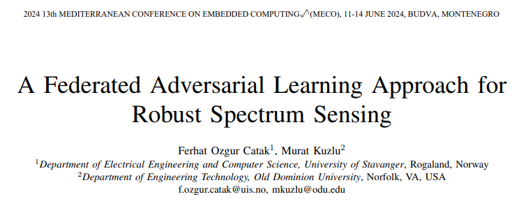
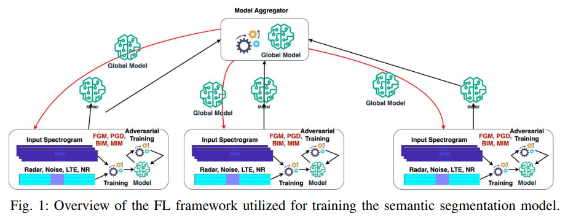
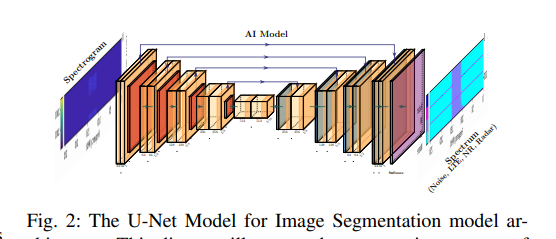
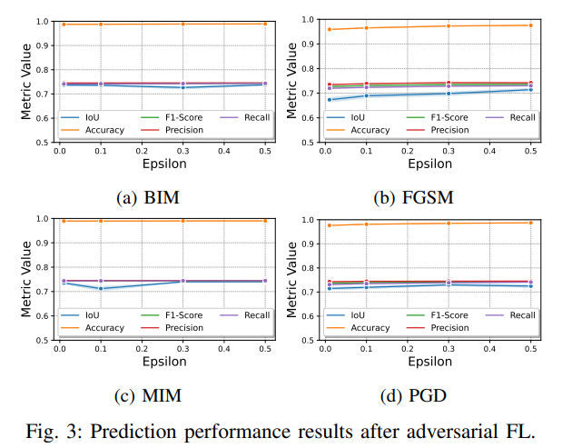

# Spectrum Sensing: A New Scheme for Robust Attack-Resistant Spectrum Sensing with Federated Learning

New Anti-Attack Spectrum Perception Scheme: Federated Learning for Robust Signal Detection
Title: A Federated Learning Method for Robust Spectrum Sensing
This paper proposes a robust federated learning method for spectrum perception applications, resistant to adversarial attacks. Spectrum perception is the process of detecting and analyzing the radio frequency spectrum in communication systems to determine available transmission frequencies. In environments where radar and wireless communication systems coexist, this scheme utilizes federated learning to train a semantic segmentation model for spectrum perception. By employing client-level adversarial training, it enhances the model's ability to resist interference. Additionally, a method for updating local models into a robust global model is designed. Experimental results demonstrate that adversarial training can strengthen the resilience of federated learning models against various types of adversarial attacks, with empirical validation from case studies confirming the robustness of this federated learning approach under adversarial threats.
In recent years, federated learning has been increasingly applied in high-risk fields such as healthcare, finance, telecommunications, etc. This distributed machine learning method trains collaborative models using multiple decentralized datasets, effectively addressing data privacy issues. However, there remains a critical issue with model robustness in federated learning; models trained on client devices are vulnerable to adversarial attacks—attackers can manipulate a small number of samples to cause model classification errors. Such attacks pose significant risks, making it crucial to develop models resistant to adversarial attacks and establish a robustness evaluation and vulnerability mitigation system for models.
In current research, federated learning and adversarial attacks are often studied separately, with only a few documents focusing on the field of federated adversarial learning. Research in the telecommunications sector is particularly absent due to the complexity and novelty of the topic. Some scholars have combined federated learning with adversarial training for applications such as speech emotion recognition and model threat mitigation. Additionally, research teams have conducted studies on adversarial resistance against AI-based models in next-generation network applications. Building on this foundation, this paper integrates federated learning with adversarial training to propose a robust federated adversarial learning method, aiming to mitigate the impact of adversarial attacks on AI-based models in next-generation network applications. The study selects spectrum perception as a case study to validate the proposed method.
Method Introduction This paper designs a federated learning system for spectrum perception tasks in the coexistence scenario of radar and wireless communication systems. The core is to train a semantic segmentation model, which is an overall distributed federated learning framework, while incorporating client-level adversarial training and model aggregation strategies. The specific methods are as follows:
1  
System Architecture: The system is deployed on N client devices, completing R rounds of training iterations, with each client performing E rounds of local model training. A convolutional neural network based on U-Net is adopted as the semantic segmentation model, which is adept at precise localization of small sample labeled data and suits the needs of spectral perception signal segmentation.
2  
Local Adversarial Training: During local training on the client side, combine raw data with adversarial examples to train the model. Four techniques are employed to generate adversarial examples: Projected Gradient Descent (PGD), Fast Gradient Method (FGM), Basic Iterative Method (BIM), and Momentum Iterative Method (MIM). These methods enhance the model's ability to resist adversarial perturbations.
3  
Dataset Construction: Utilize MATLAB's various toolboxes to synthesize radar and wireless communication signal datasets. The radar signals are modeled on an airport surveillance radar with a center frequency of 2.8GHz, while the wireless communication signals include 5G and LTE signals. At the same time, 30 scattering bodies' real channel propagation conditions are simulated. The dataset is used to train the model to distinguish radar signals and wireless communication signals within the same frequency domain.
4  
Model Aggregation and Training Process: After local training is completed by the client, the model weights are uploaded to the central server. The server aggregates all client weights through arithmetic averaging to generate an updated global model. After each round of training, the global model's performance is evaluated on an independent validation set. The training process includes core steps such as dataset partitioning, initialization of the global model, local training, weight aggregation, model updating, and validation.
Performance Evaluation Indicators: Accuracy, Precision, Recall, and F1 score are used as evaluation metrics to test the performance of the model under different types of adversarial attacks (BIM, FGM, MIM, PGD) and varying perturbation strengths (ε values from 0.01 to 0.50).
Conclusion: The robust federated learning method proposed in this study can serve as an effective defense mechanism against adversarial attacks in next-generation network applications, particularly showing strong performance in spectrum perception scenarios. This approach trains a spectral perception semantic segmentation model in a coexistence environment between radar and wireless communication systems using a federated learning framework. By combining client-level adversarial training and local model update aggregation strategies, it significantly enhances the model's resilience to interference and effectively mitigates the impact of adversarial attacks. Additionally, adversarial training significantly boosts the attack resistance performance of the federated learning model, with empirical evidence from case studies fully demonstrating its robustness against adversarial attacks, providing a new solution for anti-attack capabilities in next-generation network spectrum perception and related artificial intelligence applications.

## Images

<!-- PAYMENT_BLOCK -->

## Get this dataset

- Payment link (Stripe): [Buy now](https://buy.stripe.com/3cs8yP7sY87d0vu9AB)
- Payment QR code: 

<!-- /PAYMENT_BLOCK -->
